<!--
  SETUP (delete this comment when done)
  - Replace the REPLACE_... values: project repo names, LinkedIn, email, portfolio.
  - Visuals live in assets/ and come from tools/generate_assets.py (edit its CONFIG, run it, commit).
  - assets/stats.svg and the snake are rebuilt daily by .github/workflows/profile-assets.yml.
  - Layout note: every image is align="top" with no spaces or blank lines between tags,
    so the images stack edge to edge with no white gaps. Keep it that way when editing.
-->

