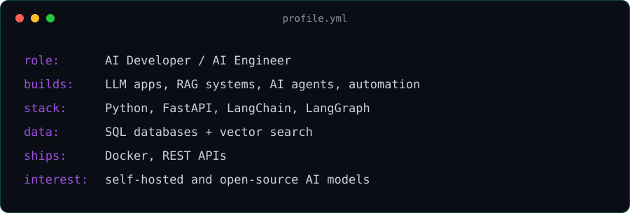

<!--
  SETUP (delete this comment when done)
  - Username is already set to Lalit-sharma123.
  - Replace the REPLACE_... values: project repo names, LinkedIn, email, portfolio.
  - The assets/ folder MUST be uploaded next to this file or the images will not show.
-->

 

**Lalit Kumar Sharma**

 

I build AI-powered software meant to be used: LLM applications, retrieval-augmented generation (RAG) systems, AI agents, and automation that connects to real databases and APIs. My work sits where models meet engineering: designing agent workflows, wiring LLMs to SQL and vector stores, serving everything through FastAPI, and packaging it with Docker.

 

 

<!--
  Each card is a clickable image. Replace REPLACE_REPO_NAME with the real repository name.
  To change card text, edit tools/generate_assets.py and run it (or edit the SVG by hand).
-->

  
  
  
  
  
  

 

  

 

<!-- If a card shows an error, the public host is rate-limited: wait, or self-host it. -->

 

<!-- Appears after you run the "Generate contribution snake" workflow once. -->
<picture>
  <source media="(prefers-color-scheme: dark)" srcset="https://raw.githubusercontent.com/Lalit-sharma123/Lalit-sharma123/output/github-snake-dark.svg" />
  <source media="(prefers-color-scheme: light)" srcset="https://raw.githubusercontent.com/Lalit-sharma123/Lalit-sharma123/output/github-snake.svg" />
  
</picture>

 

<!-- Replace each REPLACE_... value. -->

 

  

