<!--
  ============================================================
  SETUP CHECKLIST (delete this comment block when done)
  1. Username is already set to Lalit-sharma123.
  2. Replace links marked  REPLACE_...  (LinkedIn, email, portfolio, repo names, demo URLs).
  3. Keep the folder  assets/  next to this README.md.
  4. Create  .github/workflows/snake.yml  and run it once (Actions tab) so the snake exists.
  ============================================================
-->

<!-- Typing SVG. Edit the lines= list; keep + for spaces and ; between roles. -->

 

<b>Lalit Kumar Sharma</b>

<!-- Profile views (komarev.com). Remove this line if you prefer no counter. -->

---

## About

I build AI-powered software that is meant to be used: LLM applications, retrieval-augmented generation (RAG) systems, AI agents, data analytics tools, and automation that connects to real databases and APIs.

My work sits where models meet engineering: structuring data, designing agent workflows, wiring LLMs to SQL and vector stores, exposing everything through clean FastAPI services, and packaging it with Docker. I am especially interested in self-hosted and open-source models, and in AI systems that stay reliable outside a demo.

---

## AI Engineering Arsenal

Tools I work with and use in projects.

<table>
  <tr>
    <td width="150"><b>AI / ML</b></td>
    <td><code>Machine Learning</code> <code>Deep Learning</code> <code>NLP</code> <code>Computer Vision</code></td>
  </tr>
  <tr>
    <td><b>Generative AI</b></td>
    <td><code>LLMs</code> <code>RAG</code> <code>Prompt Engineering</code> <code>AI Agents</code> <code>Multi-Agent Systems</code> <code>MCP</code></td>
  </tr>
  <tr>
    <td><b>Frameworks</b></td>
    <td>
      
      
      
      
    </td>
  </tr>
  <tr>
    <td><b>Programming</b></td>
    <td>
      
      
      
    </td>
  </tr>
  <tr>
    <td><b>Data</b></td>
    <td>
      
      
      <code>Data Analytics</code> <code>Visualization</code>
    </td>
  </tr>
  <tr>
    <td><b>Databases</b></td>
    <td>
      
      
      
      
      
      
      <code>Vector Databases</code>
    </td>
  </tr>
  <tr>
    <td><b>Tools</b></td>
    <td>
      
      
      
      
      <code>REST APIs</code>
    </td>
  </tr>
</table>

---

## Featured AI Projects

<!--
  For each project: replace REPLACE_REPO_NAME with the real repository name.
  If a project has no public demo, delete the "Demo" link for that card.
  Edit the "Stack" line so it lists only what you actually used.
-->

<table>
  <tr>
    <td width="50%" valign="top">
      <h3>AI Data Analytics Platform</h3>
      <b>Problem:</b> Getting answers from business data usually needs someone who writes SQL. 
      <b>Stack:</b> <code>Python</code> <code>LLMs</code> <code>SQL</code> <code>FastAPI</code> 
      <a href="https://github.com/Lalit-sharma123/REPLACE_REPO_NAME">Repository</a> · <a href="REPLACE_DEMO_URL">Demo</a>
    </td>
    <td width="50%" valign="top">
      <h3>TaxIndia HSN Classification AI</h3>
      <b>Problem:</b> Finding the right HSN code for a product is slow and error-prone. 
      <b>Stack:</b> <code>Python</code> <code>NLP</code> <code>RAG</code> <code>Vector search</code> 
      <a href="https://github.com/Lalit-sharma123/REPLACE_REPO_NAME">Repository</a> · <a href="REPLACE_DEMO_URL">Demo</a>
    </td>
  </tr>
  <tr>
    <td valign="top">
      <h3>Hospital AI Agent</h3>
      <b>Problem:</b> Hospital information and routine queries are spread across systems and staff time. 
      <b>Stack:</b> <code>LLM agents</code> <code>LangChain</code> <code>Databases</code> 
      <a href="https://github.com/Lalit-sharma123/REPLACE_REPO_NAME">Repository</a> · <a href="REPLACE_DEMO_URL">Demo</a>
    </td>
    <td valign="top">
      <h3>TryOnAI: Virtual Fashion Try-On</h3>
      <b>Problem:</b> Shoppers can't see how clothing looks on them before buying. 
      <b>Stack:</b> <code>Computer Vision</code> <code>Generative AI</code> <code>Python</code> 
      <a href="https://github.com/Lalit-sharma123/REPLACE_REPO_NAME">Repository</a> · <a href="REPLACE_DEMO_URL">Demo</a>
    </td>
  </tr>
  <tr>
    <td valign="top">
      <h3>Personal Voice AI Assistant</h3>
      <b>Problem:</b> Everyday tasks still need typing and clicking. 
      <b>Stack:</b> <code>Speech</code> <code>LLMs</code> <code>Python</code> 
      <a href="https://github.com/Lalit-sharma123/REPLACE_REPO_NAME">Repository</a>
    </td>
    <td valign="top">
      <h3>RAG / Knowledge Intelligence Systems</h3>
      <b>Problem:</b> Teams can't quickly find answers inside their own documents. 
      <b>Stack:</b> <code>RAG</code> <code>Vector databases</code> <code>LangChain</code> <code>LangGraph</code> 
      <a href="https://github.com/Lalit-sharma123/REPLACE_REPO_NAME">Repository</a>
    </td>
  </tr>
</table>

**Analytics work already public on my profile:** [Car-Dashboard](https://github.com/Lalit-sharma123/Car-Dashboard) (Power BI) · [Madhav-E-Commerce-Dashboard](https://github.com/Lalit-sharma123/Madhav-E-Commerce-Dashboard) · [SuperStore_sales_Dashboard](https://github.com/Lalit-sharma123/SuperStore_sales_Dashboard)

<!--
  OPTIONAL: live repo cards instead of the table. Uses the public github-readme-stats instance.
  
-->

---

## Current AI Lab

  

---

## GitHub Statistics

<!-- If a card shows an error, the public host is rate-limited: wait, or self-host it (see the guide). -->
<table>
  <tr>
    <td align="center">
      
    </td>
    <td align="center">
      
    </td>
  </tr>
</table>

---

## Contribution Snake

<!-- Needs .github/workflows/snake.yml to have run once. Replace Lalit-sharma123 in BOTH URLs. -->
<picture>
  <source media="(prefers-color-scheme: dark)" srcset="https://raw.githubusercontent.com/Lalit-sharma123/Lalit-sharma123/output/github-snake-dark.svg" />
  <source media="(prefers-color-scheme: light)" srcset="https://raw.githubusercontent.com/Lalit-sharma123/Lalit-sharma123/output/github-snake.svg" />
  
</picture>

---

## Connect

<!-- Replace each REPLACE_... value. -->

 

  

