<!--
  SETUP (delete this comment when done)
  - Replace the REPLACE_... values: project repo names, LinkedIn, email, portfolio.
  - All visuals live in assets/ and are generated by tools/generate_assets.py.
    Edit the CONFIG block there, run `python tools/generate_assets.py`, commit.
  - Every image paints its own dark background, so the profile stays dark even
    when a visitor uses GitHub's light theme.
-->

<!-- If a card shows an error, the public host is rate-limited: wait, or self-host it. -->

<!-- Appears after the "Generate contribution snake" workflow runs once. Dark version is used for every theme. -->

